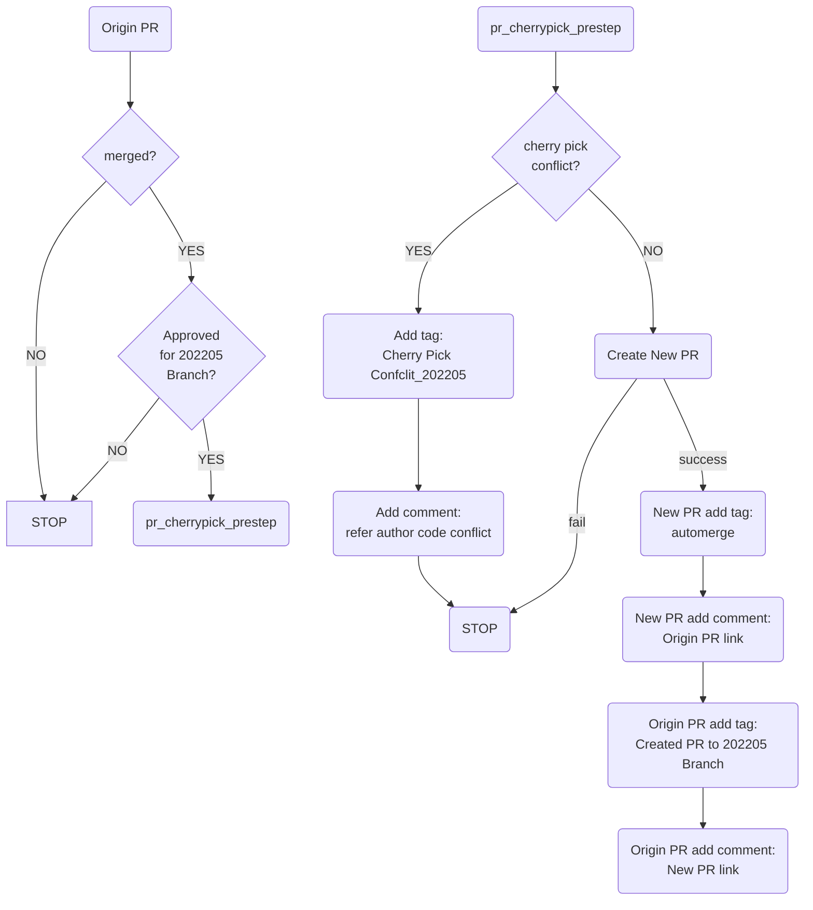
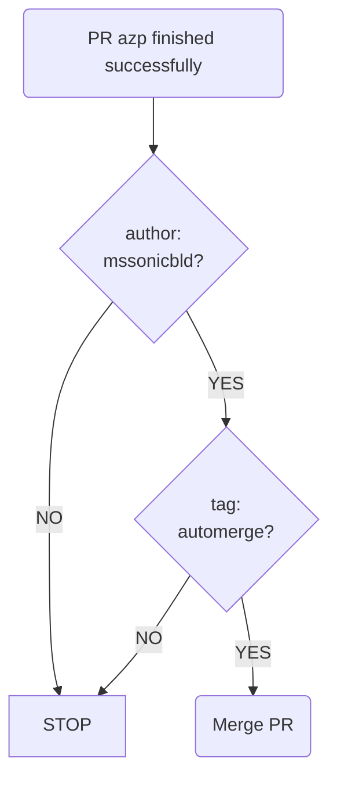
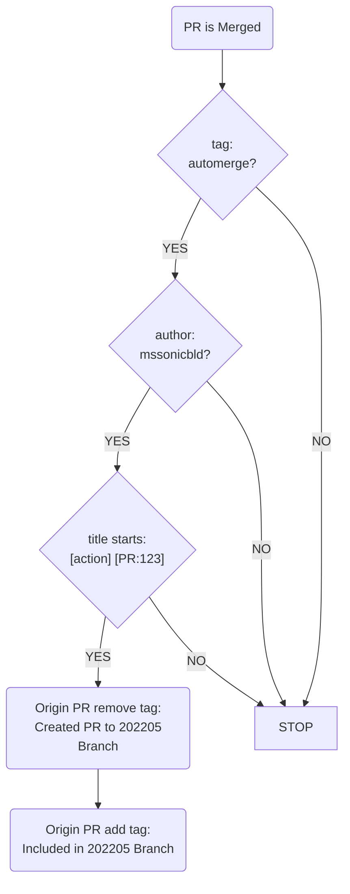

#  Github actions README
This is an introduction about auto-cherry-pick workflow.
take 202205 branch for example:
1. pr_cherrypick_prestep:


2. automerge:


3. pr_cherrypick_poststep:


## Build releases

`sonic-build.yml` publishes only after VS, Broadcom, and Teralynx all build
successfully and all recorded release assets are present. The release title
is `<branch>-v<run_number>`; its tag is `build-<branch>-<run_number>`.

GitHub release assets must be smaller than 2 GiB. Larger files are split into
1,900 MiB numbered parts, with a `.parts` file listing their order and a
`.sha256` file containing the original file's checksum. Download all matching
parts and both metadata files into one directory, then reconstruct the file:

```sh
cat $(cat sonic-vs.bin.parts) > sonic-vs.bin
sha256sum -c sonic-vs.bin.sha256
```

The reconstructed installer is byte-for-byte identical to the build output.
Files below the limit retain their existing asset names.

## Fork unit tests

`fork-unit-tests.yml` runs on every pull request and on pushes to
`202611-master`. It calls `scripts/run-fork-unit-tests.sh`, which finds the
tests by where they live, so a new test needs no workflow change:

| Location | Files | Run with |
| --- | --- | --- |
| `device/<vendor>/<platform>/tests/` | `test_*.py` | `python -m pytest` |
| `platform/**/tests/` | `test_*.py` | `python -m pytest` |
| `tests/` | `test_*.py` | `python -m pytest` |
| `files/**/tests/` | `test_*.sh` | `bash` |

- Only files directly in a `tests/` directory count, and each file runs in its
  own process. A file fails the job if it fails or collects no tests.
- The tests run on Python 3.13 (as in `sonic-slave-trixie`) without a build and
  without hardware. Mock sysfs, IPMI and STATE_DB in the test.
- `PYTHONPATH` holds the code under test (the directory containing `tests/`,
  or the first non-package directory above it), `src/sonic-py-common` and the
  pinned `src/sonic-platform-common` and `src/sonic-platform-daemons`
  (`sonic-xcvrd`). The script checks them out shallow at the pinned commits. If
  a test needs another submodule, add it to `SUBMODULES`/`PYPATH` in the
  script. PyPI packages go in `scripts/fork-unit-tests-requirements.txt`.
- A test that needs build output (swsscommon, libyang, vendor SDKs) must not be
  named `test_*.py`. For example, `tests/dpb/config_dpb_platforms_test.py` runs
  inside a sonic-utilities tree, as its README describes.
- Upstream suites that need such a build are listed in `EXCLUDE` in the
  script, and each entry says why.

Run it locally the same way, in a `python:3.13` container:

```sh
pip install -r scripts/fork-unit-tests-requirements.txt
scripts/run-fork-unit-tests.sh          # --list shows what would run
```


## Persistent compiler cache (opt in)

For `sonic-build.yml`, set `compiler_cache=true` to reuse C/C++ compilation
results when a source package changes and its whole-package cache misses.
The existing writable `cache_source` is mounted into the slave at `/dpkg_cache`;
ccache uses `.ccache-<build UID>/<build environment>/<architecture>` there, with a 5 GB
limit per directory. UID separation avoids ownership conflicts between builders.
It survives runner pods and `target/` cleanup. Move this
cache source with the runner PVC; no node-local disk is required.

An existing rules/config.user is preserved, so this input does not override it.
The default remains off pending component-CI measurements. With `cache_mode=none`
or an unavailable cache source, this option stays disabled. Package caching,
compiler flags, compiler-content checking and ccache's normal header/source
validation remain unchanged. The job prints hit/miss statistics after a successful
build. A warm single-object test demonstrates reuse, not an under-one-hour full
image build; compare representative changed-package CI runs before claiming that.
